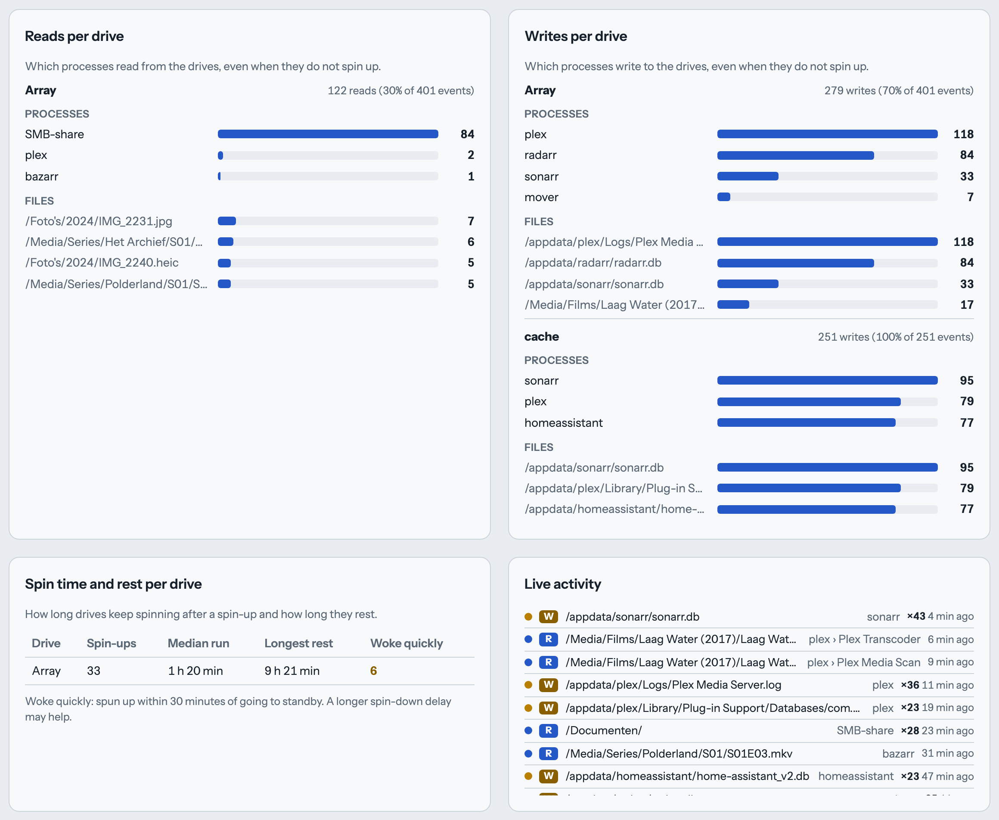

# Spin Dashboard for Unraid

See when your hard drives spin up and down, and **why**.

<picture>
  <source media="(prefers-color-scheme: dark)" srcset="docs/images/screenshot-dark.png">
  
</picture>

- **Key figures** at the top: spin-ups, spinning hours, how much of the time all drives slept and the longest full rest, each compared with the previous period, so you see right away whether a change helped.
- **Timeline per drive**, one card per pool and the array: every spin-up, how long it ran, how much of the time the drive was active, and how much data it read and wrote. SSD and NVMe pools, which never spin down, show a read/write graph instead. Each card can be hidden, moved and resized on its own.
- **Spin-ups per day**: the trend over all stored days, with the selected period highlighted. Spin-ups per hour of day cover at least the last week.
- **Activity per source**: every container or process ranked by the spin-ups it caused, with how often it read and wrote and on which drives. Click a name for its profile: figures, an activity heatmap by day and hour, its folders and files.
- **Kept awake per source**: which sources keep postponing the spin-down, and by how much spinning time.
- **Timeline per source** and **Rhythm per source**: every access per container on the same time axis as the drives, and fixed schedules recognised automatically ("every 15 min", "daily around 03:30").
- **Spin time and rest per drive**: per drive the median run after a spin-up, the longest rest, and how often it woke up again within 30 minutes of going to standby (a hint that a longer spin-down delay would help).
- The cause of each spin-up: the first file that was opened, and **who** opened it: a Docker container (Plex, Sonarr, Bazarr, …), Unraid itself (mover, cron / User Scripts, webGUI, shfs) or a user (SMB/NFS share, shell).
- **Reads vs. writes**: each access is labelled read or write, so you can see whether a drive is being read or kept busy by writes (logs, databases, metadata).
- **Overview** (the ⓘ button next to Settings): every pool and the array with their drives, and every Docker container with a coloured label per pool or the array where its folders live (both places when the mover moves them). Click through to a detail page per container, per pool or the array, and per drive: key figures, who reads and writes, what woke it, folders, files and which containers map it.
- **Container start, stop and process**: container restarts and health changes are marked on the source timeline and named when they come right before a spin-up; the feed and the profile show which process inside a container did it ("plex › Plex Media Scan").
- **Reads per drive** and **Writes per drive**: per drive the top sources and files over the selected period — answers "why is this drive never idle", even when there were no spin-ups.
- **Quiet hours**: set a window in which the drives should sleep (for example 23:00–07:00, for all drives or chosen pools). Spin-ups inside it are marked, and can be sent to a webhook (ntfy, Gotify, Discord, Slack, Home Assistant).
- **CSV export** of the selected period: spin-ups, file access with source and process, and container events, ready for a spreadsheet.
- **Live activity feed**: the most recent file events stream in as they happen (over Server-Sent Events), newest first, with an R/W marker, source and relative time.
- Click a spin-up to see every file that was opened during that session, with time and source.
- Rankings of what wakes your drives, by folder and by source.
- Browse back and forward through history: the last hour, a day at a time in the 24-hour view, a week in the 7-day view, a month (30 days) in the 30-day view.
- Available in English, Dutch, French, German and Spanish. Follows your browser language; pick another one under Settings (the gear at the top right).
- Settings also let you hide cards and change their order; the layout is remembered per browser.
- Pools and the array show as one lane each by default (a lane spins when any of its drives spins); one switch in Settings shows every drive separately.
- Hide noisy paths with wildcards under Settings › Hidden paths (for example `/mnt/user/appdata/*`); they no longer count anywhere in the dashboard. The list is stored on the server, so it is the same in every browser. The data on disk stays complete.
- Works with the array and with HDD pools (XFS, Btrfs, ZFS). SSD/NVMe pools show how much they read and write (from the kernel's counters, which never wake a drive); which file is opened by whom can be switched on per SSD pool under Settings › File access on SSD pools.
- **Reads per drive** and **Writes per drive** also cover an SSD pool once its file access is switched on.

<picture>
  <source media="(prefers-color-scheme: dark)" srcset="docs/images/active-drives-live-activity.png">
  
</picture>

## Install

**Community Applications:** search for *Spin Dashboard* and install with the defaults.

**Manual:** in Unraid, go to *Docker → Add Container → Template* and paste the template URL:

```
https://raw.githubusercontent.com/stefanrenne/spin-dashboard/main/unraid/spin-dashboard.xml
```

**docker run:**

```bash
docker run -d --name spin-dashboard \
  --privileged --pid=host \
  -p 8089:8089 \
  -v /mnt/user/appdata/spin-dashboard:/data \
  -v /mnt:/mnt:ro,slave \
  -v /var/local/emhttp:/emhttp:ro \
  -v /var/run/docker.sock:/var/run/docker.sock:ro \
  --health-cmd "python3 -c \"import urllib.request; urllib.request.urlopen('http://127.0.0.1:8089/health', timeout=4).read()\"" \
  --health-interval 60s --health-timeout 5s --health-retries 3 --health-start-period 30s \
  --restart unless-stopped \
  ghcr.io/stefanrenne/spin-dashboard:latest
```

**Docker Compose:**

```yaml
services:
  spin-dashboard:
    image: ghcr.io/stefanrenne/spin-dashboard:latest
    container_name: spin-dashboard
    privileged: true
    pid: host
    ports:
      - "8089:8089"
    volumes:
      - /mnt/user/appdata/spin-dashboard:/data
      - /mnt:/mnt:ro,slave
      - /var/local/emhttp:/emhttp:ro
      - /var/run/docker.sock:/var/run/docker.sock:ro
    environment:
      POLL_INTERVAL: "60"     # seconds between drive state checks
      RETENTION_DAYS: "30"    # days of history to keep
      # WATCH: "/mnt/disk1 /mnt/tank"  # optional, overrides automatic mount detection
      # IGNORE_PROCS: "cache_dirs"     # processes (and their children) that are not logged
    healthcheck:
      test: ["CMD", "python3", "-c", "import urllib.request; urllib.request.urlopen('http://127.0.0.1:8089/health', timeout=4).read()"]
      interval: 60s
      timeout: 5s
      retries: 3
      start_period: 30s
    restart: unless-stopped
```

The image already has this healthcheck built in; the examples above show it so you can tune it or
use it with an auto-heal container. `/health` only reports unhealthy when the drive poller is stuck or
a background thread stopped, so a missing Docker socket or a system without HDDs does not cause
restart loops. If you change `PORT`, use that port in the healthcheck too.

Keep the `/data` path on an SSD/cache pool (see [Tips](#tips)). The `/mnt`, `/emhttp` and Docker
socket mounts and the privileged/host-PID settings are explained under
[Permissions, and why](#permissions-and-why).

Open the WebUI on port 8089. The first drive check runs within a minute; file sources appear as soon as a drive is accessed.

## How it works

| Part | How |
|---|---|
| Drive state | `hdparm -C` every 60 s (falls back to `smartctl -n standby`). Neither wakes a sleeping drive. Only changes are stored. |
| Drive names | Read from Unraid's `/var/local/emhttp/disks.ini` (parity, disk1, pool members). |
| Data read and written | `/sys/block/<dev>/stat` for every drive, SSDs included, every poll: kernel counters, they never touch the drive. |
| File access | `fatrace` (fanotify) on every HDD-backed mount, including ZFS datasets, and on the SSD pools chosen in Settings. Opens, writes to open files, creates, deletes and moves, each labelled read or write. |
| Source | The process behind each access is looked up in the host process table. Containers are recognised by cgroup and named via the Docker socket. Access through `/mnt/user` passes through shfs; the dashboard then looks up which process has the file open via `/mnt/user`. |
| Storage | One plain CSV file per day in `days/` in the appdata folder, with drive states and file access together. History is kept for 30 days by default. Files from older versions (`spin.csv`, `who.csv`, …) are converted automatically on start and moved to `legacy/`. |
| Live feed | A Server-Sent Events stream (`/data/stream`) pushes every file event the moment it is logged, so the dashboard updates live. |

## Permissions, and why

| Setting | Why |
|---|---|
| Privileged | fanotify on whole filesystems needs `CAP_SYS_ADMIN`; `hdparm` needs raw access to `/dev/sdX`. |
| `--pid=host` | To see which process (and which container) opened a file. |
| `/mnt` read-only, slave | To trace file access on the array and pools. Nothing is ever written there. |
| `/var/local/emhttp` read-only | Drive names and pool membership. |
| Docker socket read-only | Only to translate container IDs into names. |

## Tips

- **Keep appdata on an SSD/cache pool.** Otherwise the dashboard's own writes keep a drive awake.
- **Exclusive shares** (*Settings → Global Share Settings → Permit exclusive shares*) let the dashboard see the real source of more accesses, because they bypass shfs.
- **Cache Dirs** (*Dynamix Cache Directories*) keeps folder listings in memory, so apps like Sonarr and Radarr can check their root folders without waking a drive. Its scans are not logged (see *Ignore processes* / `IGNORE_PROCS`). Set *Scan user shares* to *No*, otherwise the scans show up as `shfs (via /mnt/user)`.
- **Auto-updaters** such as What's Up Docker or Watchtower recreate containers. If yours uses a high update threshold, check that it handles privileged containers correctly.

## Troubleshooting

| Symptom | Check |
|---|---|
| Container shows as unhealthy | Open `/health` on the WebUI port: it says whether the poller is stuck (`poller.last_success`, `poller.error`) or a background thread stopped. |
| No drives in the dashboard | Container log: is `/var/local/emhttp` mounted and is the container privileged? |
| Spin-ups but no sources | Log should show `Watching: /mnt/…`. If not, set *Watch override* to your mounts, e.g. `/mnt/disk1 /mnt/tank`. |
| Everything shows as `shfs (via /mnt/user)` | The access was too short to trace through shfs. Exclusive shares help. |
| Containers show as their process name | The Docker socket is not mounted. |

## Development

```
python -m pytest -q      # backend tests
npm install && npm test  # frontend tests
docker build -t spin-dashboard .
```

CI (`.github/workflows/ci.yml`) runs both test suites and then builds and pushes
`ghcr.io/<owner>/spin-dashboard` on every push to `main` and on tags `v*`.
More in [`docs/`](docs/) and [`CLAUDE.md`](CLAUDE.md).

## License

MIT
